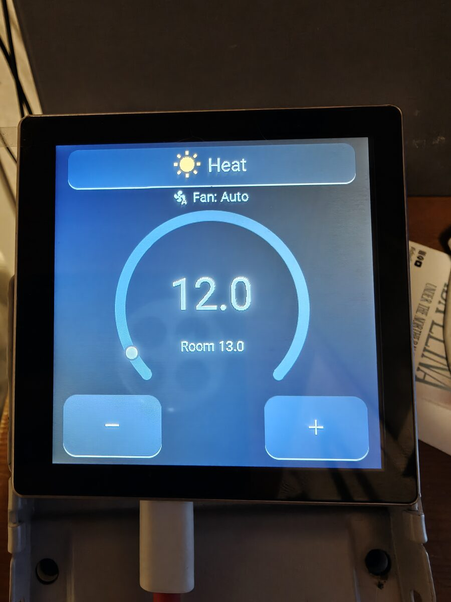
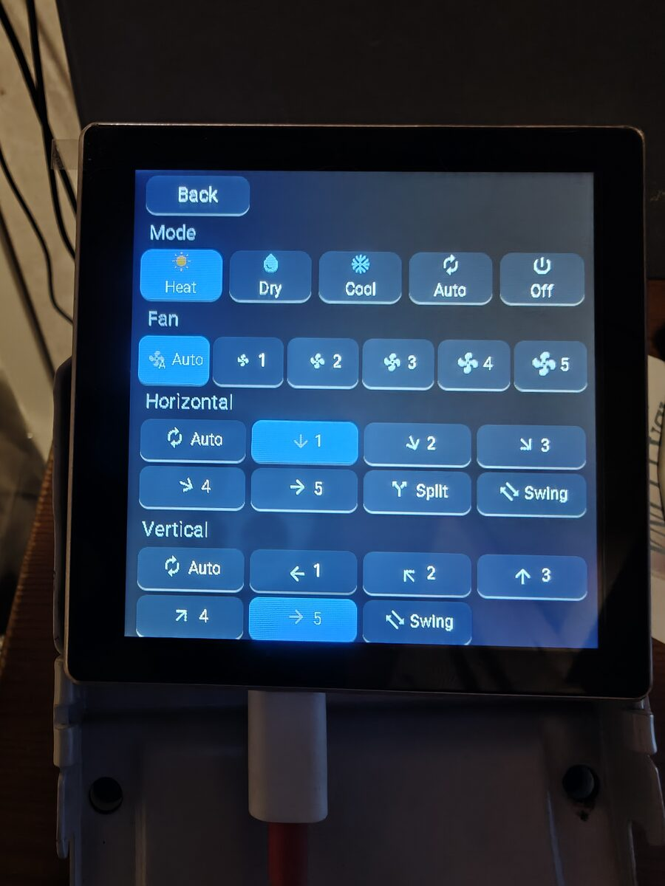

# AC panel

Wall panel for a Mitsubishi Electric air-to-air heat pump. It runs on a Guition ESP32-S3 board with a 4 inch 480×480 touchscreen (ESP32-4848S040) and talks to the unit through MelCloud, the same cloud service as the phone app and the Home Assistant integration.

The panel shows the current mode, fan, setpoint, and room temperature. A change sends only that field, so a temperature tap does not put back an older mode or fan from another controller. The temperature ring and the + / − buttons run from 12 °C to 28 °C. In Cool and Auto the heat pump’s own minimum still applies when it is higher than 12 °C.

There is no Home Assistant API or over-the-air update. Wi-Fi and the MelCloud account are entered on the panel and kept in the chip’s flash. A normal reflash leaves them there.





## One-time setup

Use Python 3.13. ESPHome 2026.4.0 and 2026.4.1 boot-loop this board; this project uses 2026.10.1.

```sh
python3.13 -m venv .venv
.venv/bin/pip install 'esphome==2026.10.1'
```

Program the board through the USB port on the bottom edge. That port is the serial adapter, so after plugging it in the device is `/dev/cu.usbserial-…` and the number can change.

```sh
.venv/bin/esphome run panel.yaml --device /dev/cu.usbserial-310
```

Replace the device path with the port from `ls /dev/cu.usbserial*`. The command compiles, uploads, and then prints the serial log. Stop the log with Ctrl-C.

The first boot has nothing saved, so the screen shows a Wi-Fi name, a password, and the address to open:

- Name: `ac-controller`
- Password: `ac-control`
- Address: `http://192.168.4.1`

Join that network from a phone. The setup page should open on its own. If it does not, open `http://192.168.4.1/`.

The form asks for:

- Wi-Fi name and password
- MelCloud username (the account email) and password
- Device id, left empty when the account has one indoor unit

Save. The panel tries the home Wi-Fi and then MelCloud three times, about 10 seconds apart. The screen says `Connecting: Wifi`, then `Connecting: MelCloud`. Show password on the form reveals what was typed, including characters such as `+`, `&`, and spaces.

If all three tries fail, the setup hotspot comes back with the form filled in. Powering the panel on after that, before any try has reached the indoor unit, opens the hotspot again.

## Clear the saved details

1. Power the panel on and wait until the top button says `Connecting: Wifi` or `Connecting: MelCloud`.
2. Tap that button five times within 10 seconds. Settings opens, and a red Reset button appears on the same row as Back.
3. Tap Reset within 30 seconds. If that time passes, Reset disappears. While the panel is still connecting, settings closes as well.
4. The next page says that RESET returns the panel to factory settings and removes the connection details. RESET does that, restarts, and shows `ac-controller` again. CANCEL returns to settings and gives another 30 seconds.

Opening the warning page keeps it up until RESET or CANCEL.

## Rebuild and flash

A change to `panel.yaml` takes effect on the next flash. Saved Wi-Fi and MelCloud details stay across that flash.

```sh
.venv/bin/esphome run panel.yaml --device /dev/cu.usbserial-310
```

To upload a binary that is already built:

```sh
.venv/bin/esphome upload panel.yaml --device /dev/cu.usbserial-310
```

## Display driver

`components/mipi_rgb` is a local copy of ESPHome’s RGB panel driver. That copy keeps ESPHome’s license, in `components/mipi_rgb/LICENSE`. The rest of this project is under the MIT license in `LICENSE`. The driver keeps a larger slice of the picture in internal memory and does not restart the video stream on every refresh, which stops the screen flashing when Wi-Fi uses the same memory bus. After an ESPHome upgrade, compare that directory with the new package and keep those two changes.

## Backplate

Backplate is not yet tested.
